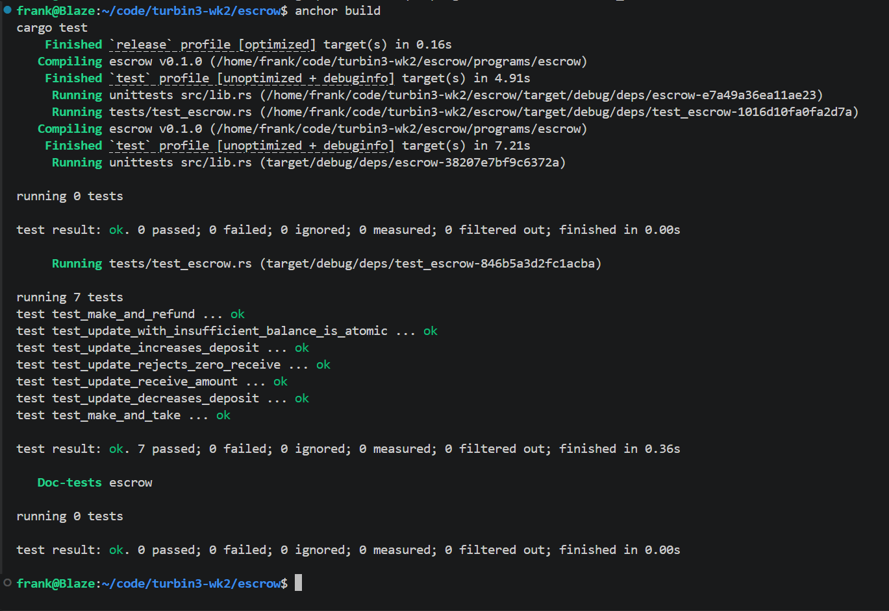

# Solana Escrow (Turbin3 Q4 2026, Week 2)

A trustless token swap on Solana, built with Anchor 1.x and tested with LiteSVM.
A maker locks token A in a program-owned vault and names a price in token B. Any taker who pays that price receives the locked tokens in the same transaction. No middleman holds the funds; the program does.

## Instructions

| Instruction | Signer | What it does |
|---|---|---|
| `make(seed, deposit, receive, expiration)` | maker | Creates the `escrow` record, creates a vault token account owned by the escrow PDA, and moves `deposit` of token A into it |
| `take` | taker | Checks the offer has not expired, pays the maker `receive` of token B, releases the full vault of token A to the taker, then closes the vault and the escrow |
| `refund` | maker | Cancels the offer: returns the vault's token A to the maker and closes the vault and the escrow |
| `update(deposit, receive)` | maker | Changes the open offer: adjusts how much token A is in the vault and the amount of token B requested |

## Accounts

| Account | Address | Holds |
|---|---|---|
| `escrow` | PDA: `["escrow", maker, seed (u64, little-endian)]` | the deal: seed, maker, mint_a, mint_b, receive, bump, expiration |
| `vault` | associated token account for `mint_a`, authority = `escrow` PDA | the locked token A |

The `seed` lets one maker run several escrows at once, each at its own address.

## Security checks

- `has_one = maker`, `has_one = mint_a` and `has_one = mint_b` on the escrow in `take` ensure the accounts passed in match the deal as recorded at `make`, so a taker cannot substitute a fake mint or a different maker
- The vault is owned by the escrow PDA, so tokens leave it only when the program signs with the escrow's seeds and stored bump (`CpiContext::new_with_signer`)
- `refund` and `update` can only be called by the maker who created the escrow
- Transactions are atomic: if any step fails, nothing changes (covered by `test_update_with_insufficient_balance_is_atomic`)

## Timed escrow (extension 4)

Each escrow stores an `expiration` (Unix timestamp). `take` reads the on-chain clock (`Clock::get()?.unix_timestamp`) and refuses with `EscrowExpired` once the offer has passed its expiration. The maker can still `refund` an expired offer.
*Not yet covered by a dedicated test; see "What I'd improve".*

## Design notes

- **Token interface:** uses `anchor_spl::token_interface`, so the program works with both SPL Token and Token-2022 mints
- **1-byte discriminator:** `#[account(discriminator = 1)]` shrinks the escrow account's type label from Anchor's default 8 bytes to 1, lowering rent; space is computed as `Escrow::DISCRIMINATOR.len() + Escrow::INIT_SPACE`
- **`Box<...>` accounts in `take`:** keeps the large account set off the 4 KB stack

## Errors

| Code | Name | When |
|---|---|---|
| 6000 | `EscrowExpired` | `take` after the offer's expiration |
| 6001 | `InvalidReceiveAmount` | a requested amount of 0 |
| 6002 | `ArithmeticOverflow` | a calculation would exceed its number type |

## Tests

7 LiteSVM tests in `programs/escrow/tests/test_escrow.rs`:

| Test | Proves |
|---|---|
| `test_make_and_take` | full swap: maker paid in token B, taker receives token A, accounts closed |
| `test_make_and_refund` | maker cancels and recovers token A |
| `test_update_receive_amount` | maker changes the price |
| `test_update_increases_deposit` | maker adds token A |
| `test_update_decreases_deposit` | maker withdraws some token A |
| `test_update_rejects_zero_receive` | a price of 0 is refused |
| `test_update_with_insufficient_balance_is_atomic` | a failed update changes nothing |



## Run it

```bash
anchor build
cargo test
```

## What I'd improve

- Add a test that `take` fails after expiration, by advancing LiteSVM's clock
- Reject `make` when `expiration` is already in the past
- Front-running protection: let the taker pass the price they expect, and have `take` refuse if `update` changed it first
- Return the vault's rent to the maker (who paid it) rather than the taker when the vault closes

## What I learned

- How a PDA can own a token account, and how the program signs for it with seeds to release tokens
- How `has_one` ties every later instruction back to the terms recorded at `make`
- Why every Solana transaction is atomic, and why that makes a swap trustless

## Credits

Built during the Turbin3 Q4 2026 Builders Cohort. The four instructions and the test suite follow the class implementation, which I rebuilt line by line in my own project.